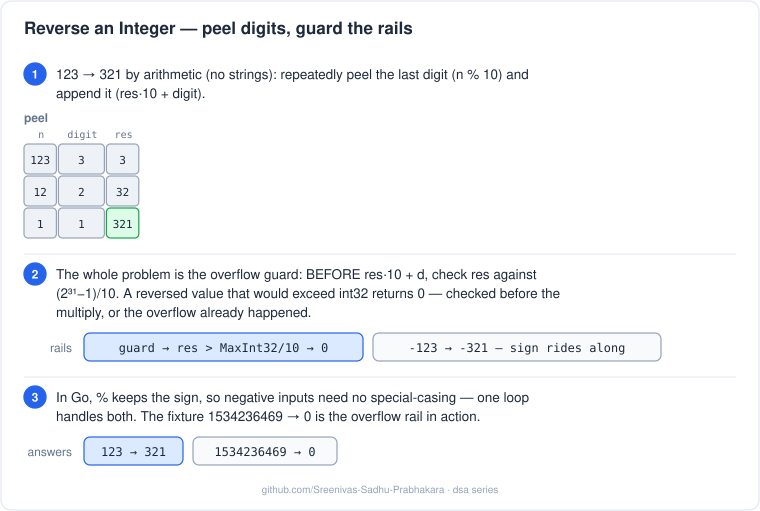

# Reverse Integer

> NeetCode 150 · Bit Manipulation — peel digits with mod and rebuild — but check the int32 limit BEFORE each append, because afterwards is too late. Go, stdlib only, tested.

## Problem

Reverse a signed 32-bit integer's digits, returning 0 if the reversal exceeds int32 range (the environment supposedly can't hold 64-bit values, so the check must not rely on computing the overflowed value).

## Approach

The digit loop is routine — `x % 10` peels, `out*10 + digit` rebuilds, and Go's sign-preserving remainder makes negatives flow through the same code (no abs, no sign flag). The problem's actual content is overflow *prediction*: before appending, `out > maxInt32/10` means the multiply alone busts the limit, and equality means the incoming digit decides (compare against `maxInt32 % 10` = 7), mirrored for the negative bound. Testing both boundary neighbors (1463847412 fits, 1534236469 doesn't) pins the prediction logic where it can actually be wrong.

**Complexity:** O(digits) time, O(1) space.

## Visual walkthrough

Read the picture top to bottom — each numbered frame is one moment of the algorithm
running on this repo's test example.

## Run

    go test ./...   # verify
    go run .        # demo

---

Part of a 275-repo DSA series in Go — Striver's SDE Sheet (dsa-001–191) plus the NeetCode 150 / Blind 75 additions (dsa-192–275), stdlib only, every solution tested. Browse: [`dsa-*` repos](https://github.com/Sreenivas-Sadhu-Prabhakara?tab=repositories&q=dsa-&type=source).
